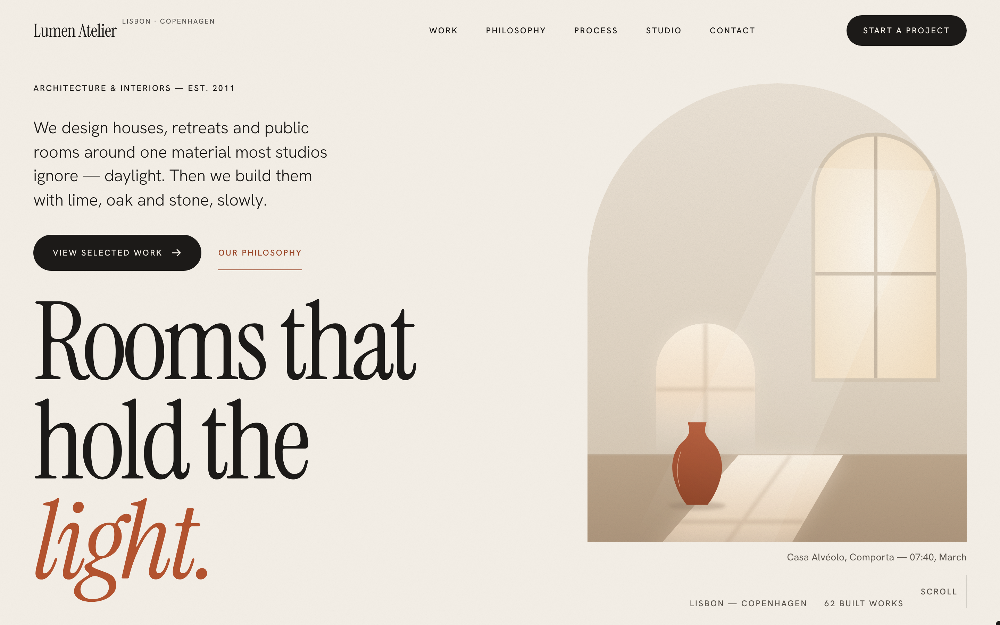
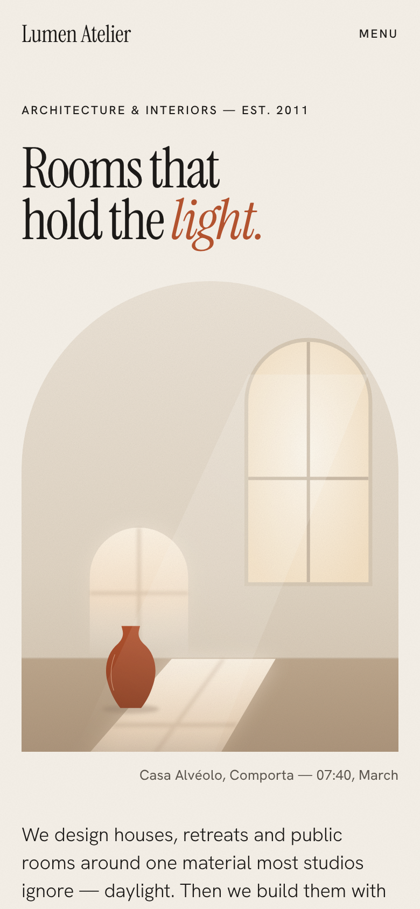

# Lumen Atelier

**A slow, light-filled marketing site for a fictional architecture and interiors studio, where every image opens like a window as you walk through the page.**

Lumen Atelier is a fictional studio in Lisbon and Copenhagen that designs with daylight. The site is built like a walk through one of their buildings: warm plaster tones, deep shadow, one terracotta accent, and heavy expo-eased motion. Nothing bounces and nothing spins.



<p align="center">
  
</p>

<details>
<summary>Full page (desktop)</summary>


</details>

---

## Features & motion highlights

- **Preloader.** A counter runs 00 → 100 and holds until the web fonts are ready. The logo rises in by character, then the panel wipes away and hands over to the hero. It plays once per session.
- **Arched hero.** The arch opens with a clip-path reveal while the image scales from 1.25 to 1. Masked lines rise into the headline, the rest fades up in sequence, and the shaft of light tilts slightly with the pointer.
- **Word-by-word scrub.** The Philosophy statement is pinned while each word brightens as you scroll, and the accent words warm to terracotta.
- **Pinned horizontal gallery.** On screens 768px and wider, vertical scroll moves a track of five projects sideways. Each card's window grows from a small arch to the full frame, the image inside drifts for parallax, and a progress bar and rolling counter (01–05) track your position. Tabbing to a card scrolls the page to that card.
- **Process steps.** A large numeral rolls as you reach each of the four steps. Layers of a line drawing are drawn on step by step, and a vertical progress line fills as you go.
- **Studio stats.** Numbers count up (rendered as their final values on the server), hairline rules grow in, and recognition rows slide up.
- **Footer.** A dusk glow brightens and the giant "Lumen Atelier" wordmark rises letter by letter as you reach the end of the page.
- **Page-level polish.** Lenis smooth scroll is tied to the GSAP ticker. The page background colour tweens between light, dark and linen sections. The header hides on scroll down, comes back on scroll up, changes colour to match the section under it, and gets a solid surface once content scrolls beneath it.
- **Micro-interactions.** A custom cursor changes between dot, link ring, "View" disc and hidden. Magnetic CTAs. Pill buttons fill from the pointer's position. The mobile menu opens with a clip wipe and its links stagger in (Framer Motion).

Animations only use `transform`, `opacity` and `clip-path`. All visuals are inline SVG "light studies", so there are no remote images.

## Tech stack

| | |
|---|---|
| Framework | [Next.js 16](https://nextjs.org) (App Router, Turbopack, static prerender) |
| Language | TypeScript (strict) |
| Styling | Tailwind CSS v4 (`@theme inline` design tokens in `globals.css`) |
| Scroll motion | [GSAP 3](https://gsap.com) with ScrollTrigger, SplitText and `@gsap/react` |
| UI motion | [Motion](https://motion.dev) (Framer Motion) for the mobile menu |
| Smooth scroll | [Lenis](https://lenis.darkroom.engineering) |
| Fonts | Instrument Serif + Hanken Grotesk via `next/font/google` |

## Project structure

```
src/
  app/            layout (fonts, boot script, providers), page, globals.css (tokens), icon, OG image
  animations/     all motion: gsap setup, SmoothScroll (Lenis), PageMotion orchestrator,
                  split/reveal helpers, cursor, and timelines/ per section
  components/
    layout/       SiteHeader, MobileMenu, NavLink, Logo, SkipLink
    sections/     Hero, Philosophy, projects/, process/, stats/, contact/
    media/        MediaFrame (arch / window / rect frame with a swappable media slot)
    visuals/      SVG light studies, ProcessVisual, shared defs, grain
    ui/           Button, TextLink, Eyebrow, SplitHeading, Tag, icons…
    preloader/    Preloader
    cursor/       Cursor
  content/        site.ts (all copy), media.ts (media slots), types.ts
  lib/            motion tokens, cn, rich-text helpers
public/images/    drop real photography here
```

The section components are server components. All animation is attached on the client by `src/animations/PageMotion.tsx` through `data-*` hooks, inside a single `gsap.matchMedia` so each breakpoint and reduced-motion variant is reverted and rebuilt cleanly.

## Getting started

Requires Node 22.

```bash
npm i
npm run dev        # http://localhost:3000
```

Other scripts:

```bash
npm run build      # production build
npm run start      # serve the production build
npm run lint       # ESLint
```

## Swapping in real photography

Every image slot is defined in **`src/content/media.ts`**. Right now each entry points to an SVG light study:

```ts
hero: { kind: "svg", variant: "hero", alt: "Illustration: morning light…" },
```

To use a photo, put the file in `public/images/` and change that entry to an `image`:

```ts
hero: {
  kind: "image",
  src: "/images/casa-alveolo.jpg",
  alt: "Morning light through the arched window at Casa Alvéolo",
  width: 1600,
  height: 2000,
},
```

`MediaFrame` then renders `next/image` inside the same arch or window frame, so the clip reveals and parallax keep working. Projects refer to slots by key (`media: "alveolo"`) in `src/content/site.ts`, which is also where all the copy lives.

## Accessibility & reduced motion

- **Semantic structure:** landmarks (`header` / `nav` / `main` / `footer`), a single `h1`, sections labelled by their headings, ordered lists for projects and process steps, and a `dl` for stats. SplitText keeps headings readable to screen readers (`aria: "auto"`).
- **Keyboard:** a skip link, a visible focus ring on every interactive element (terracotta on light, clay on dark), and a logical tab order through the pinned gallery (focusing a card scrolls it into view). The mobile menu traps focus, closes on `Esc` and returns focus to the toggle, and marks the page behind it `inert`.
- **`prefers-reduced-motion: reduce`:** Lenis, pins, scrubs, the custom cursor and magnetism are all turned off. Content renders in its final state with native scroll. The preloader becomes a short fade, and the mobile menu fades with opacity only.
- **No JavaScript:** all content is visible. The intro states are only applied by an inline boot script, which removes them again if the bundle never starts. The gallery falls back to a native horizontal scroll row.
- **Contrast:** text colour pairs meet WCAG 2.1 AA (full table in `DESIGN.md` §7). Touch targets are at least 44px.
- **Stability:** no layout shift (CLS 0 in testing) and no horizontal overflow from 390px to 1440px.

## Credits

Design & development: Your Name

The studio, projects, people and copy are fictional. Illustrations are original SVG.
